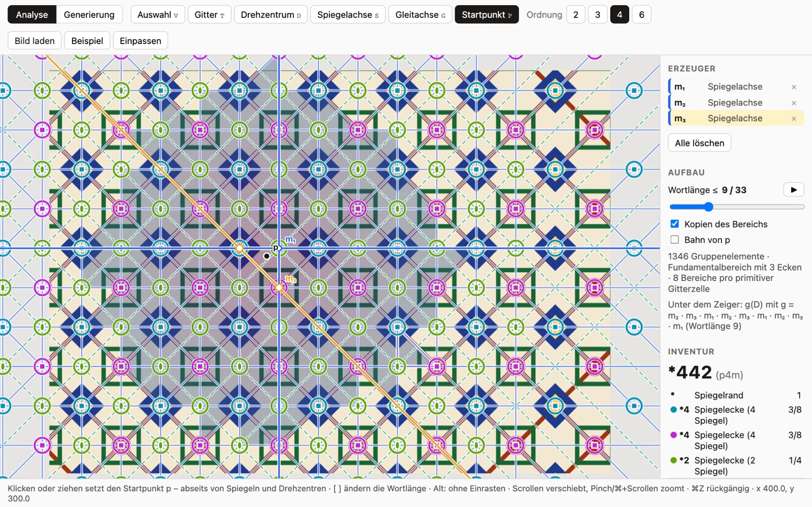

# tiler

Ein Browser-Werkzeug für Symmetrien ebener Ornamente, mit zwei Arbeitsmodi:

- **Analyse:** das Foto eines periodischen Mosaiks laden und Symmetrieelemente
  einzeichnen. Das Werkzeug prüft, ob sie zusammenpassen, bestimmt die
  Symmetriegruppe in Conway-Notation und baut das Bild aus dem
  Fundamentalbereich wieder auf, um es mit dem Original zu vergleichen.
- **Generierung:** eine der 17 Ornamentgruppen wählen, ein Bild als Motiv in den
  Fundamentalbereich legen und die Ebene damit pflastern. Das Ergebnis lässt
  sich als SVG oder PNG exportieren.




Es läuft komplett im Browser: kein Server, keine Daten verlassen den Rechner.

## Schnellstart

Gebraucht wird [Node.js](https://nodejs.org) (Version in `.nvmrc`).

```bash
npm install
npm run dev       # http://localhost:5173
```

## Analyse

1. **Bild laden** (Knopf oder hineinziehen). »Beispiel« lädt ein \*442-Testmuster.
2. **Symmetrieelemente einzeichnen:**

   | Werkzeug | Taste |
   |---|---|
   | Gitter | T |
   | Drehzentrum (Ordnung mit 2/3/4/6) | D |
   | Spiegelachse | S |
   | Gleitachse (die Länge ist der Gleitvektor) | G |

   Punkte rasten an Gitterpunkte und vorhandene Elemente ein, Achsen an
   15°-Richtungen. Alt schaltet das Einrasten ab.
3. **Verträglichkeit:** Passen die Elemente nicht zusammen (z. B. ein
   quadratisches Gitter mit einem 3-zähligen Zentrum), erscheint sofort eine
   Warnung.
4. **Inventur:** Conway-Symbol und internationaler Name, dazu die Preisprobe
   (Summe der Kosten = 2) und eine unabhängige Flächenprobe. Auf Wunsch zeigt die
   Ansicht alle Spiegel, Gleitachsen und Drehzentren der Gruppe, die Zentren nach
   Bahnklasse eingefärbt.
5. **Startpunkt p** (Taste P):
   - zeigt den Fundamentalbereich D (Dirichlet-Bereich von p) und seine Kopien;
   - der Regler baut die Kopien schrittweise nach Wortlänge in den Erzeugern auf;
   - unter dem Zeiger steht das Gruppenelement, das D in diese Kopie abbildet.
6. **Fundamentalbereich wählen:** neben der Voronoi-Zelle von p gibt es den
   **Orbifold**, also den kanonischen Bereich der Gruppe:
   - Spiegel bilden seinen Rand.
   - Drehzentren und Spiegelecken sind seine Ecken, eingefärbt nach Bahnklasse.
   - Die übrigen Kanten sind paarweise markiert. Gleiche Striche bedeuten
     verklebt, und zwar durch eine Drehung (schwarz), eine Translation
     (violett) oder eine Gleitspiegelung (grün gestrichelt). Der Pfeil zeigt die
     Richtung.
   - p wählt die Kopie.

   Kopien, Prüfung am Bild und Generierung arbeiten mit jedem der beiden
   Bereiche.
7. **Prüfung am Bild:**
   - »Aus D« setzt das Bild nur aus dem Inhalt von D zusammen.
   - »Differenz« zeigt, wo das vom Original abweicht.
   - Als Vergleichsmaßstab dient das Bild, gegen sich selbst verschoben.
8. **In Generierung übernehmen:** Die erkannte Gruppe, p und das Bild wandern in
   den Generierungsmodus.

## Orbifold (3D)

Der mittlere Modus zeigt das Muster aus der Analyse oder aus der Generierung in
3D, mit three.js. Erste Stufe ist der **Torus** ℝ²/Λ: Die Ebene wird aufgefasst,
als wären Punkte, die sich um eine Gitterverschiebung unterscheiden, derselbe
Punkt. Als Textur dient eine Gitterzelle, aufgebaut aus Kopien von D und darum
nahtlos (`src/cell.ts`, `src/orbifold3d.ts`).

- **Verzerrung:** Ein flacher Torus lässt sich im Raum nicht unverzerrt bauen.
  Darum dehnt der Donut die Textur außen und staucht sie innen; der mittlere
  Ring der Röhre ist maßstabsgetreu. Ist die Röhre zu dick, wird sie verkürzt,
  und schiefe Gitter werden geschert. Die Ansicht gibt alle Faktoren an.
- **Regler:** Er verschiebt die Textur entlang der Röhre, also die willkürliche
  Wahl, welcher Streifen außen liegt.
- **Schalter:** Er tauscht, welcher Gittervektor um die Röhre läuft.

Die Ansicht **Orbifold** zeigt den eigentlichen Quotienten aus Ebene und
Symmetriegruppe als Körper, gebaut durch Rollen oder Falten des kanonischen
Bereichs D (`src/bodies.ts`):

| Gruppe | Körper |
|---|---|
| \*2222, \*442, \*333, \*632 | der ausgeschnittene Bereich selbst (Spiegelvieleck) |
| \*\* | Zylinder, beide Ränder Spiegel |
| 4\*2, 3\*3, 2\*22 | Kegeltüte um die Kegelspitze, Rand Spiegel |
| 442, 632, 333 | Kissen: D gefaltet, doppelt belegtes Dreieck |
| 22\* | Tasche, offen entlang des Spiegels |
| 2222 | Tetraeder (Dreieck aus 2-Zentren, entlang des Mittendreiecks gefaltet) |
| o | der Torus |
| \*x | Möbiusband, Rand Spiegel |
| xx | Kleinsche Flasche (Achterform) |
| 22x | Kreuzhaube (projektive Ebene) mit den zwei Kegelspitzen auf der Durchdringungslinie |

- **Verzerrung:** Alle diese Körper sind unverzerrt. Getestet wird, dass jede
  Strecke ihre Länge behält und verklebte Kanten im Raum aufeinanderliegen.
  Einzige Ausnahme sind Kissen und Taschen: Der Regler »Aufblähen« macht sie
  räumlich und dehnt die Textur dabei leicht.
- **Markierungen:** Dieselben Markierungen wie im Muster liegen auch auf
  Körper und Torus: Spiegelkanten, paarweise markierte Klebekanten mit Pfeil
  sowie Zentren mit ihrer Zähligkeit, in der Farbe ihrer Klasse. Sie werden für
  alle Kopien von D in die Textur gezeichnet und passen darum an den Klebestellen
  zusammen. Bei Körpern aus D selbst sitzen sie knapp innerhalb der Kanten.
  Auf den Körpern zeigen farbige Kugeln die Kegelspitzen und Spiegelecken (statt
  der Symbole in der Textur), auf dem Torus die Symbole. Alles lässt
  sich mit einem Schalter ausblenden.
- **Nicht-orientierbare Fälle:** \*x, xx und 22x lassen sich im Raum nicht
  unverzerrt bauen, für die Kleinsche Flasche und die Kreuzhaube nicht einmal
  ohne Selbstdurchdringung.
  - Dargestellt werden sie mit Standard-Immersionen eines Rechtecks aus dem
    Muster. Das Rechteck ist so geschnitten, dass seine Kanten genau so
    verklebt sind, wie die Immersion es verlangt.
  - Getestet wird, dass es ein Fundamentalbereich ist und dass Randpunkte, die
    die Gruppe identifiziert, auf denselben Punkt des Körpers fallen.
  - Die Ansicht gibt den typischen Dehnungsbereich an.
  - Bei Möbiusband und Kleinscher Flasche verschiebt ein Regler die Textur
    entlang der Spiegel bzw. Gleitachsen. Das ist der einzige stetige
    Freiheitsgrad, den diese Gruppen lassen.

### Malen auf dem Orbifold

Im Orbifold-Modus lässt sich direkt auf den 3D-Körper oder den Torus malen:
Haken bei »Malen« setzen, dann auf der Fläche ziehen. Zieht man neben dem
Körper, dreht sich die Ansicht weiterhin.

- **Speicherung:** Jeder Strich wird in Musterkoordinaten gespeichert. Über die
  Texturkoordinate des getroffenen Punkts kommt man vom Körper zurück zum
  Muster.
- **Darstellung:** Jeder Strich wird unter allen Gruppenelementen gezeichnet.
  Darum läuft er über Spiegel und Klebekanten weiter, und auf dem Torus
  erscheint er in allen Kopien.
- **Werkzeuge:** Farbe, Pinselbreite, Rückgängig (⌘Z) und Alles löschen.
- **Gruppenwechsel:** Ändert sich die Symmetriegruppe, wird die Malerei
  gelöscht.

## Generierung

- **Gruppe wählen.** Je nach Gittertyp stellt man Zellgröße, Seitenverhältnis
  und Winkel ein.
- **Motiv:** »Bild laden« oder »Beispiel«.
  - Ziehen verschiebt das Motiv. Auch in gespiegelten oder gedrehten Kopien
    folgt es dem Zeiger.
  - Größe und Drehung stellt man mit Reglern ein.
- **Form von D:** Voronoi-Zelle von p oder Orbifold, wie in der Analyse.
  Den Punkt p ziehen ändert die Form der Voronoi-Zelle bzw. wählt die Kopie
  des Orbifolds.
- **Export des sichtbaren Ausschnitts:**
  - Ist das Motiv ein SVG, entsteht ein SVG. Das Motiv steht darin einmal in
    `<defs>`, jede Kopie ist ein `<use>` mit Transformation und Clip auf D.
  - Sonst entsteht ein PNG in doppelter Auflösung.

Verschieben: Leertaste oder rechte Maustaste und ziehen, oder scrollen.
Zoomen: ⌘/Strg und scrollen. »Einpassen«: Taste F.

## Wie es funktioniert

- **Isometrien** sind affine Abbildungen p ↦ M·p + t (`src/isometry.ts`).
- **Gruppe aus Erzeugern** (`src/group.ts`):
  - Breitensuche über Wörter in den Erzeugern und ihren Inversen, mit Wortlänge.
  - Doppelte Elemente werden über einen räumlichen Hash erkannt.
  - Die Suche endet, wenn ein Element das Zentrum weiter als einen Radius
    verschiebt.
- **Fundamentalbereich** (`src/construction.ts`):
  - Er ist die Voronoi-Zelle von p in seiner Bahn, berechnet durch
    Halbebenen-Schnitt.
  - Die Kopie unter einem Punkt ist die mit dem nächsten Bahnpunkt.
- **Inventur** (`src/inventory.ts`):
  - Drehzentren werden per Union-Find in Bahnklassen zusammengefasst. Gehen
    Spiegel durch ein Zentrum, ist es eine Spiegelecke, sonst eine Kegelspitze.
  - Spiegel ergeben einen Rand, wenn sie sich schneiden, sonst einen pro Klasse
    paralleler Spiegel.
  - Ein x gibt es, wenn eine Gleitspiegelung die spiegelfreie Kammer von p auf
    sich abbildet. Wie viele es sind, folgt aus der Preisprobe.
- **Orbifold** (`src/canonical.ts`): eine Konstruktion für alle 17 Gruppen.
  - Die Form hängt nur von der Gruppe und diesen Regeln ab, nie von p. Wo die
    Gruppe eine Wahl offen lässt, entscheidet ein fester Bezugspunkt: der
    erste Punkt des zuerst eingezeichneten Elements, in der Generierung der
    Nullpunkt. Offen bleibt eine Wahl bei Klassen gleicher Ordnung, z. B. den
    drei Klassen von 3-Zentren bei 333, und bei Schnitten, die durch kein
    Zentrum gehen (\*\*, \*x, xx, o). Gebaut wird am Bezugspunkt; p wählt danach
    nur die Kopie.
  - Mit Spiegeln: eine Spiegelkammer.
    - Liegt darin eine Kegelspitze der Ordnung n, wird ein 1/n-Keil der Kammer
      genommen.
    - Bei parallelen Spiegeln: eine Periode des Streifens, geschnitten an
      Drehzentren bzw. an der Gleitachse.
  - Ohne Spiegel: die Voronoi-Zelle eines Zentrums höchster Ordnung unter seiner
    eigenen Bahn, in n Keile geschnitten. Die Strahlen laufen durch die Zentren
    niedrigster Ordnung, für 442 ergibt das das Viereck 4-2-4-2.
  - Sonst: ein Streifen zwischen Gleitachsen bzw. das Gitterparallelogramm.
  - Die Partnerkanten findet das Tool unter den Gruppenelementen.
  - Getestet für alle 17 Gruppen an mehreren Startpunkten: genau einmal
    pflasternd, jede Kante Spiegel oder verklebt, kein Spiegel im Inneren, jede
    Klasse als Ecke.
- **Die 17 Gruppen** (`src/groups.ts`):
  - Jede ist als Gittertyp plus Nebenklassenvertreter in Gitterkoordinaten
    abgelegt.
  - Für die Generierung werden die Kopien als Gittertranslation ∘ Nebenklasse
    aufgezählt (`src/tiling.ts`).
  - Aus einer Analyse gewinnt `realizationFromConstruction` Gitter und
    Nebenklassen zurück.

## Entwicklung

```bash
npm test          # Vitest
npm run typecheck
npm run build     # statische Dateien nach dist/ (relative Pfade, z. B. für GitHub Pages)
npm run preview   # den Build lokal ansehen
```

| Datei | Inhalt |
|---|---|
| `src/isometry.ts`, `src/group.ts` | Isometrien, Gruppenerzeugung |
| `src/construction.ts` | Bahn, Dirichlet-Bereich, Warnungen |
| `src/inventory.ts`, `src/orbifold.ts` | Conway-Notation, Preisprobe |
| `src/canonical.ts` | kanonischer Fundamentalbereich (Orbifold) mit Verklebungen |
| `src/overlay.ts` | Prüfung am Bild |
| `src/groups.ts`, `src/tiling.ts` | die 17 Gruppen, Pflasterung für die Generierung |
| `src/scene.ts`, `src/view.ts` | eingezeichnete Elemente, Einrasten; Verschieben und Zoomen |
| `src/draw.ts`, `src/main.ts` | Zeichnen und Bedienung (Analyse) |
| `src/generate.ts` | Zustand, Zeichnen, Export (Generierung) |
| `tests/` | u. a. alle 17 Gruppen: Erkennung, lückenlose Pflasterung, Rückgewinnung aus der Analyse |

Die Tests von Gruppenkern, Inventur und Pflasterung laufen ohne Browser. Die
Bedienoberfläche ist von Hand und mit Playwright geprüft.

## Herkunft

tiler begann als Python-Paket, ein Jupyter-Widget zum Pflastern mit einer
vorgegebenen Gruppe. Diese Browser-Version löst es ab; die Python-Fassung ist
nur noch in der Git-Historie zu finden. Ihre Gruppentabelle lebt in
`src/groups.ts` weiter, mit einer Korrektur: dort waren p3m1 und p31m
vertauscht.

## Lizenz

MIT, siehe [LICENSE](LICENSE).
