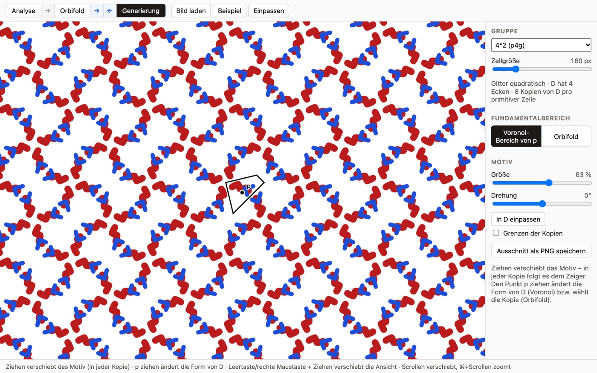
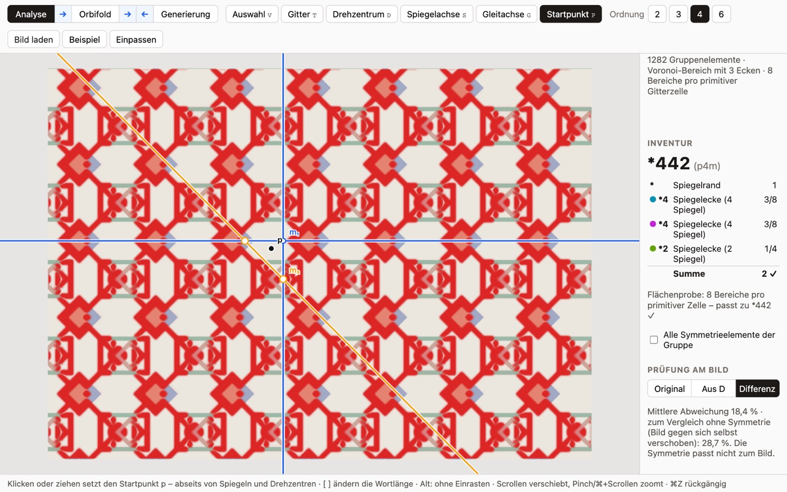
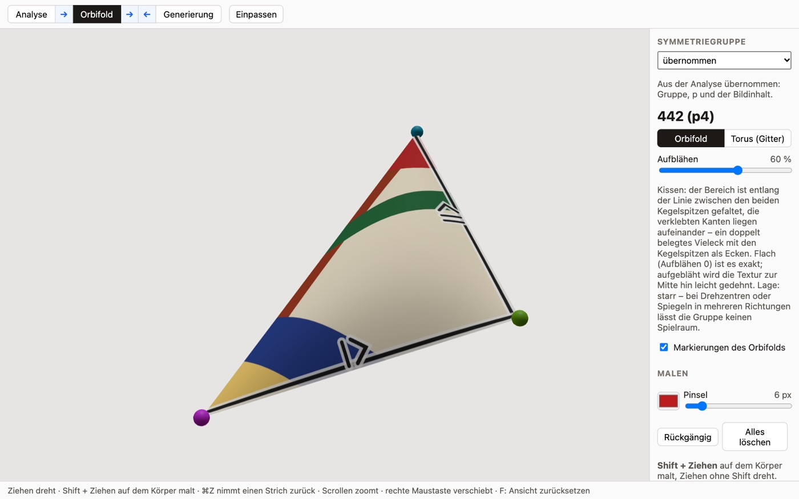
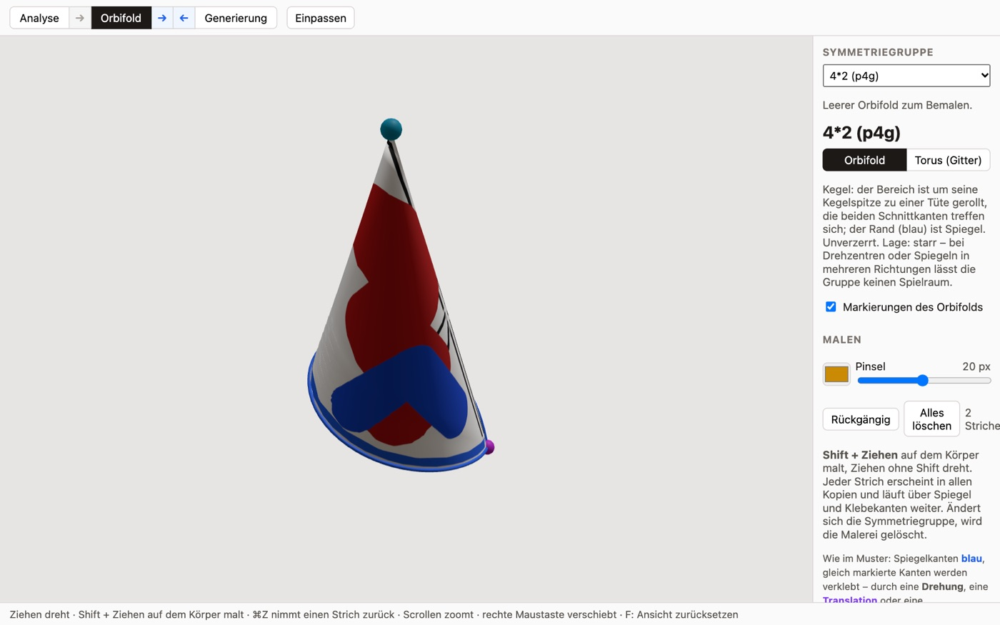
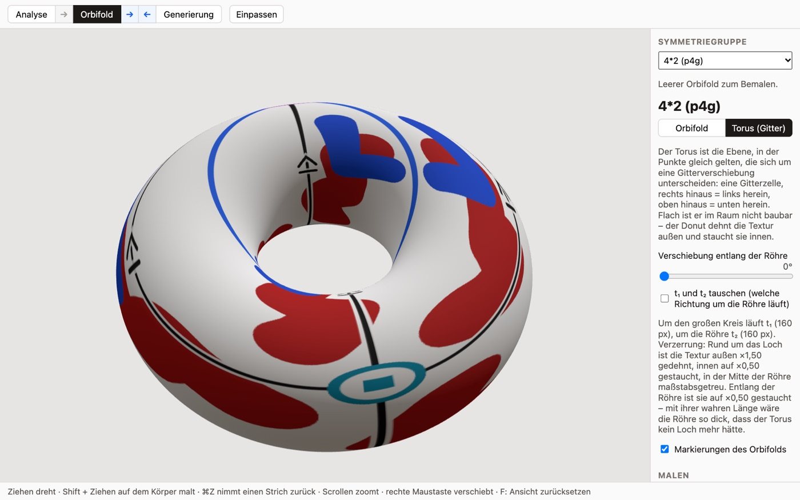
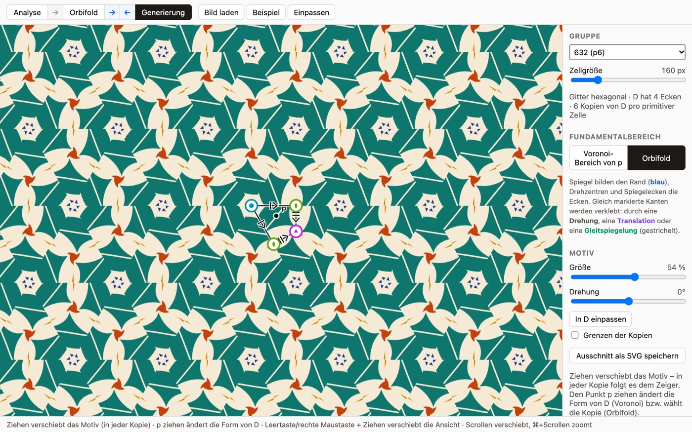

# tiler

Symmetrien in Mosaiken entdecken, sie als räumlichen Körper ansehen und
bemalen und daraus eigene Ornamente erzeugen. Alles läuft direkt im Browser.

**Ausprobieren:** https://linusmeienberg.github.io/tiler/



## Worum es geht

Fliesen, Tapeten, Stoffe und Mosaike wiederholen ihr Motiv nach festen Regeln:
Sie lassen sich verschieben, drehen oder spiegeln, ohne sich zu verändern.
Mathematisch gibt es dafür genau **17 Möglichkeiten**, die 17
Ornamentgruppen. tiler hilft,

- herauszufinden, welche davon ein Mosaik hat;
- den **Orbifold** zu sehen, also das kleinste Stück, aus dem sich das ganze
  Muster ergibt, zusammengeklebt zu einem Körper;
- aus einem Bild oder einer eigenen Malerei ein neues Muster zu machen.

Dafür gibt es drei Modi, umschaltbar oben links:

| Modus | wofür |
|---|---|
| **Analyse** | ein Foto laden, Spiegel und Drehpunkte einzeichnen, die Symmetrie bestimmen und prüfen |
| **Orbifold** | den Orbifold in 3D drehen, ansehen und bemalen |
| **Generierung** | eine Symmetrie wählen, ein Motiv hineinlegen, das Muster exportieren |

Die kleinen blauen Pfeile zwischen den Reitern übergeben, woran man gerade
arbeitet, an den nächsten Modus.

Es gibt keinen Server: Bilder und Zeichnungen verlassen den Rechner nicht.

## Anwendungsbeispiele

### 1. Die Symmetrie eines Mosaiks bestimmen


1. Im Modus **Analyse** ein Foto laden (»Bild laden« oder Datei
   hineinziehen). »Beispiel« lädt ein Testmuster.
2. Symmetrieelemente einzeichnen, die man im Bild sieht. Meist genügen zwei
   oder drei:
   - **Spiegelachse** (Taste S): entlang einer Linie ziehen, an der das Muster
     gespiegelt ist;
   - **Drehzentrum** (Taste D): auf einen Punkt klicken, um den sich das Muster
     drehen lässt. Mit 2, 3, 4 oder 6 wählt man, wie oft es sich bei einer
     vollen Umdrehung wiederholt;
   - **Gleitachse** (G) und **Gitter** (T), falls nötig.

   Punkte rasten an passenden Stellen ein, Alt schaltet das ab.
3. Rechts unter **Inventur** erscheint die Symmetriegruppe, z. B. **\*442
   (p4m)**. Haken bei »Alle Symmetrieelemente der Gruppe« zeigt alle Spiegel
   und Drehpunkte, die daraus folgen. Passen die Elemente nicht zusammen, warnt
   tiler sofort.
4. Mit dem **Startpunkt** (Taste P) einen Punkt ins Bild setzen. Dann sieht
   man den Fundamentalbereich, also das Stück, aus dem das Muster entsteht, und
   seine Kopien. Der Regler »Wortlänge« baut sie Schritt für Schritt auf.

### 2. Prüfen, ob die eingezeichnete Symmetrie stimmt



Unter **Prüfung am Bild**:

- **Aus D** setzt das Bild nur aus dem Inhalt des Fundamentalbereichs neu
  zusammen.
- **Differenz** zeigt rot, wo das vom Original abweicht.

Dazu nennt tiler eine Zahl und ein Urteil. Im Bild oben liegen die Spiegel 15
Pixel daneben. Die Gruppe ist in sich stimmig, passt aber nicht zum Foto, und
genau das zeigt die Differenz.

### 3. Den Orbifold eines Mosaiks in 3D ansehen



1. In der Analyse die Gruppe einzeichnen und p setzen, wie in Beispiel 1.
2. Auf den Pfeil **→** zwischen »Analyse« und »Orbifold« klicken.

Der ausgeschnittene Bildinhalt wird zum Körper gefaltet oder gerollt, hier
zu einem Kissen. Jede Gruppe hat ihren eigenen Körper: Kegel, Zylinder,
Tetraeder, Möbiusband und mehr (siehe [Der Orbifold als
Körper](#der-orbifold-als-körper)).

- Linksziehen dreht, rechts ziehen verschiebt, Scrollen zoomt.
- **Markierungen** zeigen, welche Kanten zusammengeklebt sind (gleiche
  Striche) und wo die Drehpunkte liegen (farbige Kugeln).
- **Torus (Gitter)** zeigt statt des Orbifolds die ganze Gitterzelle als
  Donut.

### 4. Einen Orbifold bemalen und daraus ein Muster machen



1. Im Modus **Orbifold** eine Symmetriegruppe im Dropdown wählen. Es erscheint
   ein leerer, weißer Orbifold.
2. Mit **Shift + Ziehen** auf den Körper malen, Farbe und Pinselbreite in der
   Seitenleiste. Jeder Strich setzt sich über die Klebekanten fort, ⌘Z nimmt
   ihn zurück.
3. **Torus (Gitter)** zeigt, wie die Malerei sich in der Gitterzelle
   wiederholt:

   

4. Der Pfeil **→** zwischen »Orbifold« und »Generierung« macht daraus ein
   Muster (Bild ganz oben). Dort lässt es sich als PNG speichern.

### 5. Ein Ornament aus einem eigenen Bild erzeugen



1. Im Modus **Generierung** eine Gruppe wählen und Zellgröße usw. einstellen.
2. »Bild laden« oder »Beispiel«: Das Bild wird in den Fundamentalbereich
   gelegt, und die Ebene füllt sich.
3. Das Motiv mit der Maus verschieben, Größe und Drehung mit den Reglern
   anpassen.
4. »Ausschnitt speichern« exportiert den sichtbaren Ausschnitt. Ist das Motiv
   ein SVG, ist auch das Ergebnis ein SVG, sonst ein PNG.

Der Pfeil **←** bringt das Muster als Orbifold zurück in die 3D-Ansicht.

## Bedienung auf einen Blick

| | Maus und Tasten |
|---|---|
| alle Modi | Scrollen verschiebt, ⌘/Strg + Scrollen zoomt, F passt die Ansicht ein |
| Analyse | V Auswahl, T Gitter, D Drehzentrum (2/3/4/6 = Ordnung), S Spiegel, G Gleitachse, P Startpunkt, Entf löscht, ⌘Z rückgängig, Alt ohne Einrasten, [ ] Wortlänge |
| Orbifold | Ziehen dreht, Shift + Ziehen malt, rechte Maustaste verschiebt, ⌘Z nimmt einen Strich zurück |
| Generierung | Ziehen verschiebt das Motiv, den Punkt p ziehen ändert den Bereich, Leertaste + Ziehen verschiebt die Ansicht |

## Hintergrund

### Symmetriegruppen und Conway-Notation

Ein periodisches Muster hat Verschiebungen in zwei Richtungen als Symmetrie
(ein **Gitter**), dazu je nach Muster **Drehungen** um 180°, 120°, 90° oder
60°, **Spiegelungen** und **Gleitspiegelungen** (spiegeln und dabei
verschieben). Die Gesamtheit dieser Symmetrien ist die Symmetriegruppe. Es gibt
genau 17 Möglichkeiten.

tiler schreibt sie in der **Orbifold-Notation von Conway**, daneben steht der
kristallographische Name (z. B. p4m):

| Zeichen | Bedeutung |
|---|---|
| Ziffer n vor dem \* | ein Drehzentrum der Ordnung n, durch das kein Spiegel geht (Kegelspitze) |
| \* | ein Spiegel(rand) |
| Ziffer n nach dem \* | eine Ecke, in der sich n Spiegel treffen (Spiegelecke) |
| x | eine Gleitspiegelung, die keinen Spiegel kreuzt |
| o | nur Verschiebungen |

Beispiel: **\*442** heißt Spiegel, an denen sich Ecken mit 4, 4 und 2 Spiegeln
bilden. Jedes Zeichen hat einen Preis (n → (n−1)/n, \*n → (n−1)/2n, \* und x
→ 1, o → 2), und bei jedem ebenen Muster ergibt die Summe genau 2. tiler zeigt
diese Preisprobe in der Inventur, dazu eine unabhängige Flächenprobe.
Mathematisch ist die Summe 2 die Bedingung, dass der Orbifold flach ist
(Euler-Charakteristik 0), siehe Conway & Huson, *The Orbifold Notation for
Two-Dimensional Groups* (2002).

### Fundamentalbereich: Voronoi oder Orbifold

Der **Fundamentalbereich** D ist ein Stück der Ebene, dessen Kopien unter
allen Symmetrien die Ebene genau einmal bedecken. tiler bietet zwei Wahlen:

- **Voronoi-Bereich von p:** alle Punkte, die näher an p liegen als an jeder
  Kopie von p. Seine Form hängt von p ab.
- **Orbifold (kanonisch):** Spiegel bilden den Rand, Drehzentren und
  Spiegelecken die Ecken, und die übrigen Kanten sind paarweise verklebt. Seine
  Form ist durch die Gruppe festgelegt; p wählt nur, welche Kopie gezeigt
  wird. Wo die Gruppe eine Wahl offen lässt (z. B. welche Klasse von
  Drehzentren bei 333 auf die Faltkante kommt), entscheidet ein fester
  Bezugspunkt: das zuerst eingezeichnete Element bzw. der Nullpunkt.

### Der Orbifold als Körper

Der Orbifold ist der Fundamentalbereich mit seinen Verklebungen, also die
Ebene »geteilt durch die Gruppe«. tiler baut ihn als Körper:

| Gruppe | Körper | unverzerrt? |
|---|---|---|
| \*2222, \*442, \*333, \*632 | der Bereich selbst, flach, Rand ganz aus Spiegeln | ja |
| \*\* | Zylinder, beide Ränder Spiegel | ja |
| 4\*2, 3\*3, 2\*22 | Kegeltüte um die Kegelspitze, Rand Spiegel | ja |
| 442, 632, 333 | Kissen: der Bereich gefaltet, Kegelspitzen als Ecken | ja (flach), aufgebläht leicht gedehnt |
| 22\* | Tasche, offen entlang des Spiegels | wie Kissen |
| 2222 | Tetraeder, die vier Ecken sind die vier Arten von 2-Zentren | ja |
| o | Torus (Donut) | nein |
| \*x | Möbiusband, Rand Spiegel | nein |
| xx | Kleinsche Flasche (durchdringt sich selbst) | nein |
| 22x | Kreuzhaube = projektive Ebene, mit zwei Kegelspitzen | nein |

Die unverzerrten Körper entstehen durch Rollen oder Falten, wie bei Papier.
Für die anderen gibt es im Raum keine unverzerrte Form, beim Torus etwa wäre
außen zu wenig und innen zu viel Fläche. tiler zeigt sie trotzdem und nennt
den Dehnungsbereich der Textur.

**Torus:** Jedes Muster hat ein Gitter, und die Ebene, in der man um
Gitterverschiebungen versetzte Punkte als gleich ansieht, ist ein Torus (wie
eine Spielwelt, in der man rechts hinaus- und links wieder hineinläuft). Er
trägt eine ganze Gitterzelle, also so viele Kopien des Orbifolds, wie die
Flächenprobe Bereiche pro Zelle nennt. Ein Regler verschiebt, welcher Streifen
außen liegt.

**Freiheitsgrade:** Stetig verschieben lässt sich die Textur nur, wo eine
Richtung von allen Symmetrien respektiert wird. Das ist bei o, \*\*, \*x und xx
der Fall, dort gibt es einen Regler. Bei allen Gruppen mit Drehzentren oder
Spiegeln in mehreren Richtungen ist die Lage starr.

### Wie tiler rechnet

- **Isometrien** sind affine Abbildungen p ↦ M·p + t (`src/isometry.ts`).
- **Gruppe aus Erzeugern** (`src/group.ts`): Breitensuche über Wörter in den
  eingezeichneten Elementen und ihren Inversen, mit Wortlänge. Doppelte
  Elemente erkennt ein räumlicher Hash, und die Suche endet in einem Radius um
  den Startpunkt.
- **Voronoi-Bereich** (`src/construction.ts`): Halbebenen-Schnitt mit den
  Mittelsenkrechten zu den Kopien von p. Die Kopie unter einem Punkt ist die
  mit dem nächsten Bahnpunkt.
- **Inventur** (`src/inventory.ts`):
  - Drehzentren werden per Union-Find in Klassen zusammengefasst. Gehen
    Spiegel durch ein Zentrum, ist es eine Spiegelecke, sonst eine Kegelspitze.
  - Spiegel ergeben einen Rand, wenn sie sich schneiden, sonst einen pro Klasse
    paralleler Spiegel.
  - Ein x gibt es, wenn eine Gleitspiegelung die spiegelfreie Kammer von p auf
    sich abbildet. Wie viele, folgt aus der Preisprobe.
- **Kanonischer Bereich** (`src/canonical.ts`): eine Konstruktion für alle 17
  Gruppen.
  - Mit Spiegeln: eine Spiegelkammer, bei einer Kegelspitze darin ein 1/n-Keil,
    bei parallelen Spiegeln eine Periode des Streifens.
  - Ohne Spiegel: die Voronoi-Zelle eines Zentrums höchster Ordnung unter
    seiner eigenen Bahn, in n Keile geschnitten. Bei 442 ergibt das das
    Viereck 4-2-4-2.
  - Partnerkanten werden unter den Gruppenelementen gesucht.
- **Körper** (`src/bodies.ts`): Rollen und Falten des kanonischen Bereichs.
  Für \*x, xx und 22x werden Standardformen über einem Rechteck verwendet, das
  so aus dem Muster geschnitten ist, dass seine Kanten passend verklebt sind.
- **Die 17 Gruppen** (`src/groups.ts`) sind als Gittertyp plus
  Nebenklassenvertreter abgelegt. Für die Generierung werden die Kopien als
  Gitterverschiebung ∘ Nebenklasse aufgezählt (`src/tiling.ts`).
- **Prüfung am Bild** (`src/overlay.ts`): Kopien von D in einer Canvas
  zusammensetzen und die mittlere Farbdifferenz zum Original bilden. Als
  Maßstab dient das gegen sich selbst verschobene Bild.
- **Malen** (`src/orbifold3d.ts`): Ein Strahl vom Mauszeiger trifft den
  Körper, und über die Texturkoordinate kommt man zurück zum Punkt im Muster.
  Striche werden in Musterkoordinaten gespeichert und unter allen
  Gruppenelementen gezeichnet.

Getestet wird u. a. für alle 17 Gruppen, dass sie erkannt werden, dass die
Fundamentalbereiche die Ebene genau einmal pflastern, dass die Körper unverzerrt
sind (bzw. verklebte Kanten im Raum aufeinanderliegen) und dass die Form des
Orbifolds nicht von p abhängt.

## Entwicklung

Gebraucht wird [Node.js](https://nodejs.org) (Version in `.nvmrc`).

```bash
npm install
npm run dev       # http://localhost:5173
npm test          # Vitest
npm run typecheck
npm run build     # statische Dateien nach dist/
npm run preview   # den Build lokal ansehen
```

Jeder Push auf `main` wird getestet und auf GitHub Pages veröffentlicht.

| Datei | Inhalt |
|---|---|
| `src/isometry.ts`, `src/group.ts` | Isometrien, Gruppenerzeugung |
| `src/construction.ts` | Bahn, Voronoi-Bereich, Warnungen |
| `src/inventory.ts`, `src/orbifold.ts` | Conway-Notation, Preisprobe |
| `src/canonical.ts` | kanonischer Bereich (Orbifold) mit Verklebungen |
| `src/overlay.ts` | Prüfung am Bild |
| `src/groups.ts`, `src/tiling.ts` | die 17 Gruppen, Pflasterung |
| `src/scene.ts`, `src/view.ts`, `src/draw.ts`, `src/main.ts` | Analyse: Elemente, Ansicht, Zeichnen, Bedienung |
| `src/bodies.ts`, `src/cell.ts`, `src/orbifold3d.ts`, `src/orbsource.ts` | Orbifold-Modus: Körper, Texturen, 3D-Ansicht, Malen |
| `src/generate.ts` | Generierung und Export |
| `tests/` | Tests (Vitest) |

## Lizenz

[CC BY-NC 4.0](https://creativecommons.org/licenses/by-nc/4.0/): Nutzen,
weitergeben und verändern ist für nicht-kommerzielle Zwecke erlaubt, mit
Namensnennung (»tiler« von Linus Meienberg, mit Link auf dieses Repository).
Volltext in [LICENSE](LICENSE).
